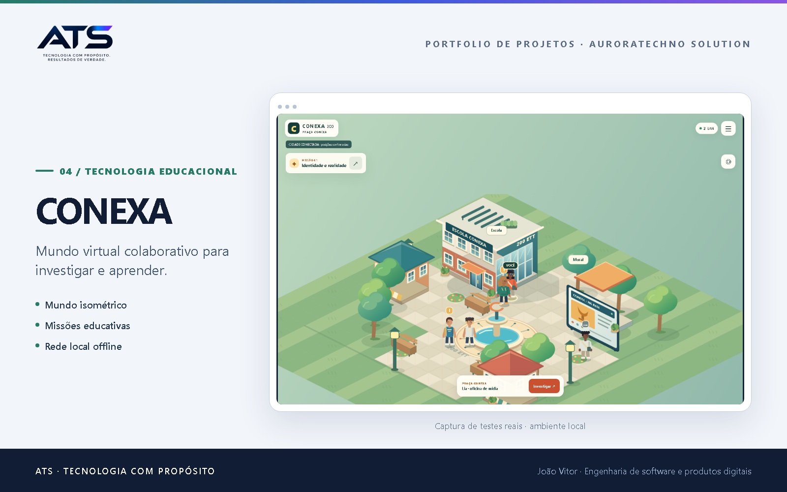
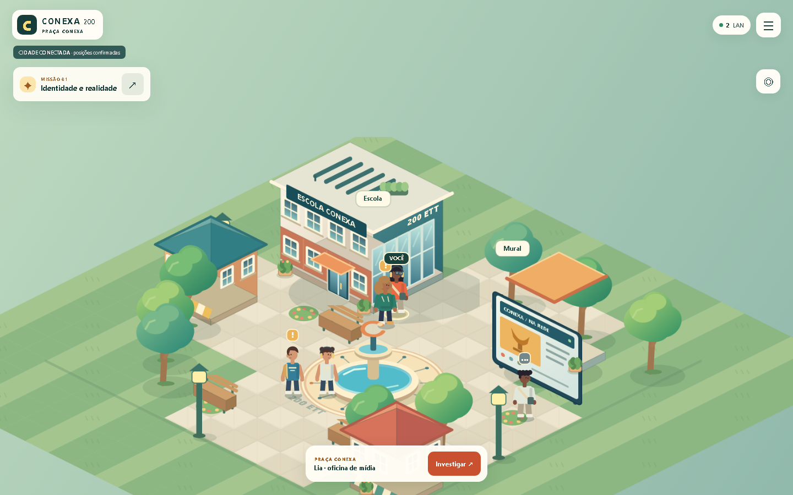
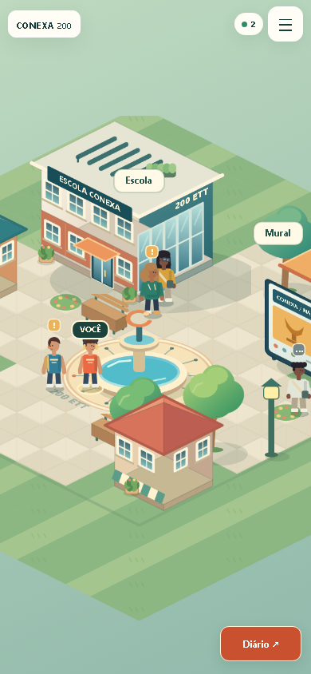
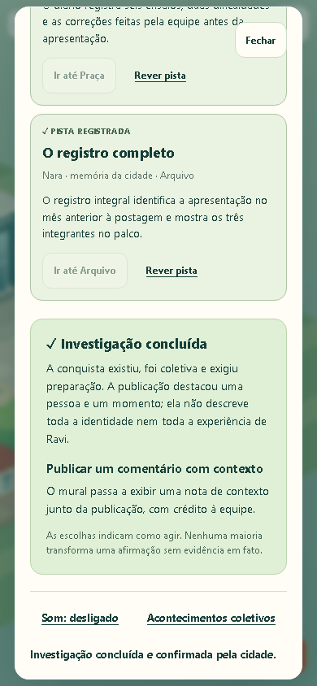
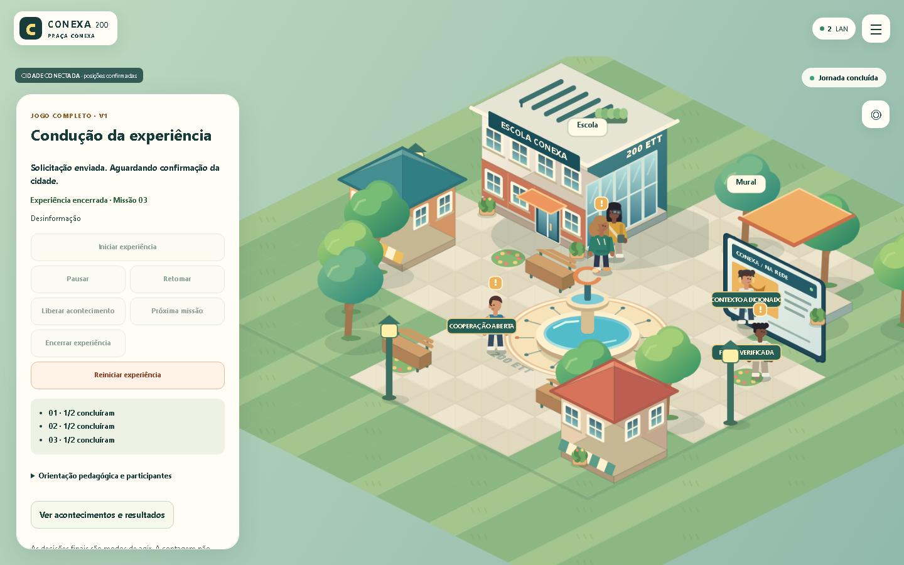
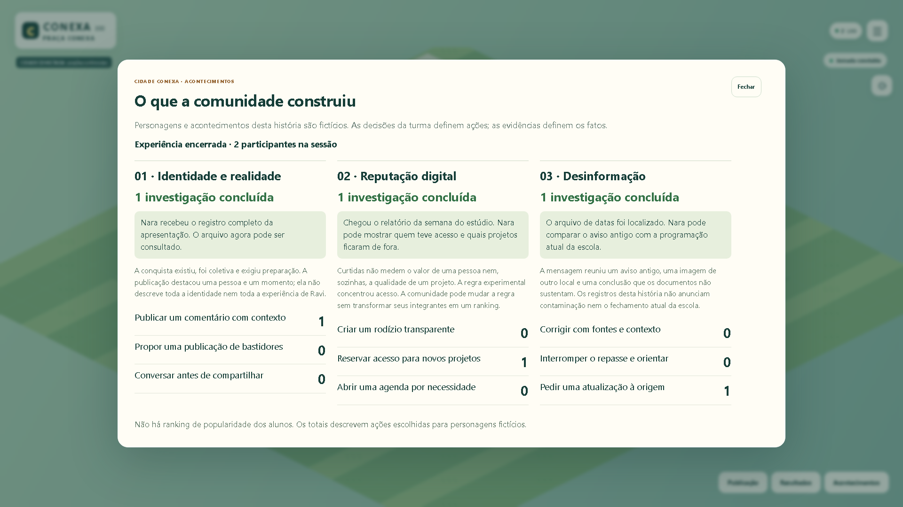
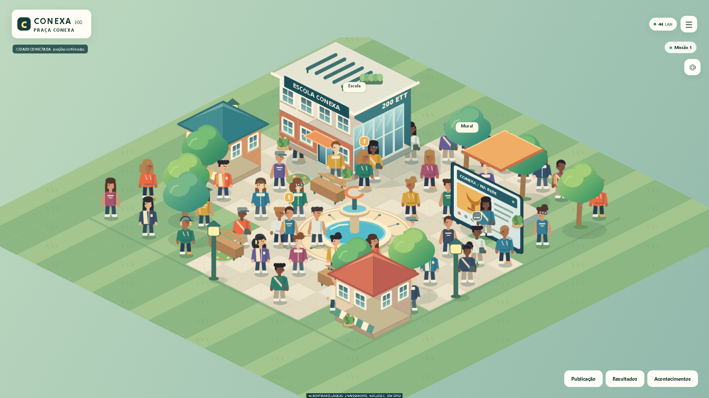

# CONEXA

**Cidade virtual multiplayer offline para educação e cidadania digital.**

[Português](#visão-geral) · [English summary](#english-summary)



## Visão geral

CONEXA é uma experiência didática da AuroraTechno Solution, desenvolvida para atividades coletivas de Educação Digital sem dependência de conexão com a internet. Alunos exploram uma cidade isométrica 2.5D, conversam com personagens, reúnem evidências e resolvem investigações sob condução do professor.

O sistema original foi projetado para uma ESP32-C6 com 16 MB de Flash em rede local dedicada. Este snapshot inclui o firmware-fonte e um harness de demonstração local que executa os mesmos núcleos C, sem placa ou backend externo.

## Funcionalidades

- Três investigações: identidade e realidade, reputação digital e desinformação.
- Cidade isométrica com NPCs, avatares procedurais e movimento compartilhado.
- Quatro fontes por investigação, associação de evidências e decisões com consequências.
- Interface responsiva para aluno, professor e projetor.
- Controle docente de início, pausa, retomada, liberação, avanço e encerramento.
- Códigos individuais, estado autoritativo, recuperação na mesma execução, controle de sequência e idempotência.
- Resultados coletivos sem exposição das escolhas individuais; 44 identidades lógicas.

## Demonstração visual

Capturas reais do snapshot em navegador, com códigos e personagens sintéticos.

### Mundo virtual


### Investigação no celular



### Professor e projeção coletiva




## Arquitetura

| Camada | Tecnologia |
| --- | --- |
| Interface e renderização | HTML, CSS, JavaScript e Canvas 2D |
| Regras e estado de sessão | C11: game_core e world_core |
| Hardware-alvo | ESP32-C6 / ESP-IDF, HTTP em LAN |
| Demonstração local | Node.js HTTP em loopback + executável C nativo |
| Validação | Node Test Runner, unittest, Playwright |

O firmware serve uma página HTML offline comprimida em gzip. A ESP32 é a autoridade do estado no cenário físico; no harness, as regras são executadas pelos mesmos arquivos C. O estado permanece em RAM e não sobrevive ao reinício do servidor ou da placa.

## Executar a demonstração local (Windows CMD)

Requisitos: Node.js 24, Python 3.12, compilador C nativo compatível com GCC ou MSVC. Não é necessário ESP32, Firebase ou serviço pago.

Em um Developer Command Prompt do Visual Studio (ou CMD com GCC no PATH):

```cmd
python tools\prepare_avatars.py --empty
python tools\build_assets.py
set CC=cl
node tests\build_v1_host.mjs
set CONEXA_TEST_PORT=4175
node tests\v1_server.mjs
```

Com GCC, use `set CC=gcc` em vez de `set CC=cl`. O servidor de teste escuta exclusivamente em 127.0.0.1. Abra no navegador:

- Aluno: http://127.0.0.1:4175/
- Professor: http://127.0.0.1:4175/professor
- Projetor: http://127.0.0.1:4175/projetor

Códigos fictícios exclusivos do harness: professor `BTESTTEACHER`; alunos `BTESTSTUDENT01` a `BTESTSTUDENT44`. Abra o professor em outra aba ou contexto, inicie a experiência e entre como aluno. Encerre com Ctrl+C.

## Testes

Instalação inicial dos recursos de teste (requer internet):

```cmd
npm install
npx playwright install chromium
python -m pip install Pillow
python tools\prepare_demo_fixture.py
node --test tests/test_*.mjs
python -m unittest discover -s tests -p "test_*.py" -v
node tests\browser_game_v1.mjs
node tests\browser_v1_44.mjs
node tests\browser_v1_p0.mjs
node tests\browser_world_recovery.mjs
```

Validação desta versão: 54 testes Node/C e 28 testes Python aprovados (82 no total); 47 verificações integradas de navegador aprovadas, abrangendo as três investigações completas, 44 identidades lógicas, regressão da enquete e recuperação espacial. Nenhum acesso físico à ESP32 foi realizado.

Execute depois de compilar o host nativo conforme acima. Os artefatos de teste são mantidos em `evidence/` (ignorada). O fixture de avatar é um manequim abstrato criado por código, nunca uma foto de aluno.

## Firmware e limites

O firmware-fonte, configuração de compilação e ferramenta de geração de credenciais estão incluídos. A preparação para hardware exige a toolchain ESP-IDF 6.1 compatível, configuração de rede criada localmente com `python tools/configure.py`, os dois cabeçalhos gerados pelos comandos de preparação e revisão de compatibilidade da placa. Não reutilize os códigos fictícios do harness no firmware. Nenhuma gravação física é executada pela demonstração.

O firmware usa HTTP/Bearer em LAN controlada, sem TLS; não exponha à internet. A validação de 44 identidades por HTTP e dois clientes Chromium não representa teste de carga com 44 dispositivos reais, rádio, energia ou memória dinâmica da ESP32. Este repositório é um snapshot de portfólio, não uma homologação de produção. As configurações locais, tokens, fotografias, binários, históricos e evidências internas não são publicados.

- [Arquitetura e contratos](docs/ARQUITETURA_V1.md)
- [Manual pedagógico](docs/PROFESSOR_V1.md)

## Créditos

Desenvolvimento: João Vitor Silva Carvalho Costa — AuroraTechno Solution. Dependências externas são referenciadas pelos respectivos manifestos e permanecem sujeitas às suas licenças. Nenhuma nova licença geral de código aberto é concedida sobre o código próprio da ATS.

## English summary

CONEXA is an educational offline multiplayer experience designed for a local ESP32-C6 network. Students explore an isometric city and investigate digital identity, reputation and misinformation. This public portfolio snapshot includes the C11 game cores, Canvas interface, firmware source, teaching guide and a local Node.js test harness with synthetic participants. Physical 44-device capacity has not been established by the local validation.
